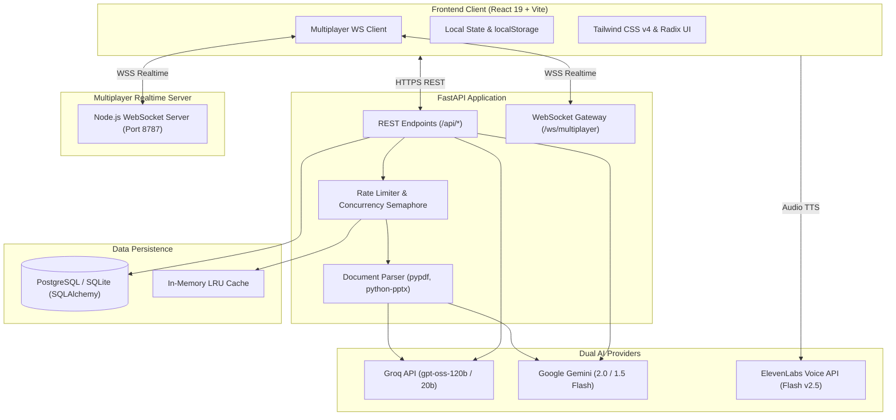
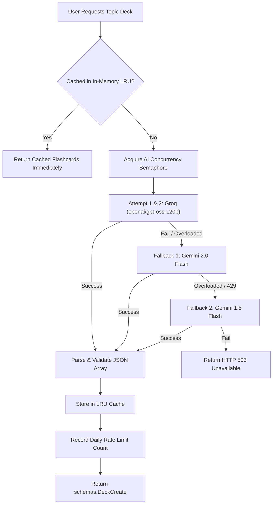
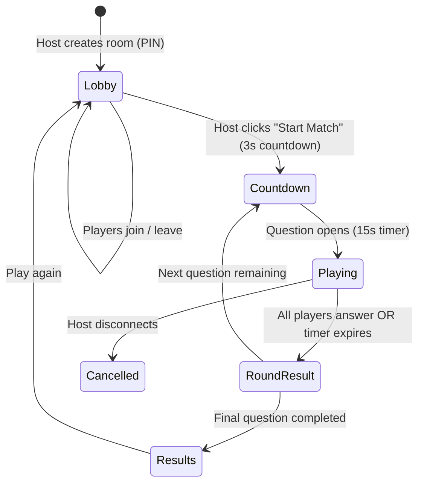

# 🏛️ CramZero System Architecture

This document details the architectural design, data flow, AI failover pipeline, database schemas, and real-time networking protocols powering CramZero.

---

## 1. High-Level System Overview

---

## 2. Frontend Architecture

- **Core Framework:** React 19 running on Vite 8.
- **Styling & Design System:** Tailwind CSS v4 with custom warm parchment palette (`#FBF9F5`, `#F8F5EE`, `#F3EFE7`, `umber`, `taupe`, `sand`, `greige`) alongside dark mode support via Tailwind `dark:` variants.
- **Component Primitives:** Customized Radix UI / Shadcn UI components (Buttons, Cards, Inputs, Textareas, Badges, Switches, Progress bars, Avatars).
- **Smooth Navigation:** View transitions utilize `document.startViewTransition()` with fallback to instant React state updates.
- **Adaptive Layouts:** Adaptive max-width containers and motion stabilization ensure study components, buttons, and flashcard containers scale reliably across mobile (320px–480px), tablet (768px), and desktop (1024px+) viewports.
- **Audio Synthesis:** Seamless hybrid TTS combining ElevenLabs Flash v2.5 API with browser native `window.speechSynthesis` fallback.

---

## 3. Dual AI Engine & Failover Pipeline

CramZero implements a robust, fault-tolerant dual AI architecture designed to prevent 429 (rate-limit) and 503 (model overloaded) errors from interrupting student study sessions.

### 3.1 Prompt Deck Generation (`/api/generate-deck/`)

### 3.2 Document File Generation (`/api/generate-deck-from-file/`)

CramZero allows uploading `.pdf`, `.pptx`, and `.txt` files to extract terms and generate structured decks. Because Groq lacks native multi-modal file ingestion, the backend automatically transitions to pure text extraction when Gemini is unavailable.

1. **Phase 1 (Primary - Native File Processing):**
   - The file is saved to a secure temporary path.
   - Uploaded directly to Google Gemini Files API.
   - Processed via `gemini-2.0-flash` or `gemini-1.5-flash`.
   - File is immediately deleted from Gemini remote servers after synthesis.

2. **Phase 2 (Secondary - Automatic Groq Fallback):**
   - Triggered if Gemini upload fails, credentials are missing, or all Gemini models return 429/503.
   - The backend runs `extract_text_from_file_path()`:
     - `.pdf`: Extracted per page using `pypdf.PdfReader`.
     - `.pptx`: Slide shapes and textframes parsed using `python-pptx.Presentation`.
     - `.txt`: Decoded using multiple fallback encodings (`utf-8`, `utf-8-sig`, `latin-1`, `cp1252`).
   - The document content is safely truncated to 25,000 characters (~6,000 tokens) to ensure rapid completion without exceeding token bounds.
   - Dispatched to Groq (`openai/gpt-oss-120b`, falling back to `openai/gpt-oss-20b`).
   - Cleaned, parsed into valid flashcard schema, and returned.

3. **Cleanup:**
   - Temporary local files are guaranteed to be unlinked in a `finally` block.

---

## 4. Concurrency & Rate Limiting System

To prevent external AI API quota exhaustion and protect server health:

- **AI Concurrency Semaphore:** `AI_CONCURRENCY_SEMAPHORE = threading.Semaphore(3)` limits concurrent heavy LLM completions.
- **Client Rate Limits:**
  - `deck_generation`: 25 actions/day per client identifier (authenticated user ID or IP).
  - `readout`: 30 actions/day per client.
  - `chat`: 60 interactions/day per client.
- **Identifier Resolution:** Uses authenticated `user_id` when present, falling back to client IP extracted from `X-Forwarded-For` or request client host.

---

## 5. Database Schema & Auto-Migration

CramZero uses SQLAlchemy ORM with support for **PostgreSQL** (Neon / Render / Supabase) and **SQLite** (local development).

### 5.1 Tables

- **`users`**:
  - `id`: String(64) primary key.
  - `email`: String(255) nullable, unique.
  - `password_hash`: String(255) hashed with `hashlib.sha256` + salt.
  - `display_name`: String(120) default 'Student'.
  - `avatar_url`: Text URL.
  - Timestamps (`created_at`, `updated_at`).

- **`decks`**:
  - `id`: Integer primary key.
  - `title`: String(255).
  - `description`: Text.
  - `visibility`: 'Private' or 'Public'.
  - `user_id`: String(64) foreign reference.
  - `author_name`: String(120).
  - `created_at`: DateTime.

- **`cards`**:
  - `id`: Integer primary key.
  - `deck_id`: ForeignKey to `decks.id` (cascade delete).
  - `term`: Text.
  - `definition`: Text.

- **`study_hubs`**:
  - `id`: Integer primary key.
  - `name`: String(255).
  - `description`: Text.
  - `invite_code`: String(12) unique (6-digit alphanumeric code).
  - `owner_id`: String(64).
  - `owner_name`: String(120).
  - `allow_member_uploads`: Boolean.

- **`study_hub_members`**:
  - `id`: Integer primary key.
  - `hub_id`: ForeignKey to `study_hubs.id`.
  - `user_id`: String(64).
  - `display_name`: String(120).
  - `role`: 'Admin' or 'Member'.

- **`study_hub_decks`**:
  - `id`: Integer primary key.
  - `hub_id`: ForeignKey to `study_hubs.id`.
  - `deck_id`: ForeignKey to `decks.id`.
  - `shared_by`: String(64).

- **`api_usage`**:
  - `identifier`: String(128).
  - `action`: String(64).
  - `date_str`: YYYY-MM-DD.
  - `count`: Integer.

---

## 6. Real-Time Multiplayer Protocol

The multiplayer battle engine synchronizes quiz sessions between hosts and joiners over WebSockets.

### 6.1 State Machine

### 6.2 Clock Synchronization
To prevent lag or timing differences across devices:
- Server sends `serverTime` (epoch ms) in state updates.
- Clients compute `serverOffset = serverTime - Date.now()`.
- Question timers compute remaining time against `questionStartedAt` plus `serverOffset`, keeping host and joiner countdown clocks strictly aligned.

